# Appts

By Weng (Weng Fei Fung)

<a target="_blank" href="https://github.com/Siphon880gh" rel="nofollow"></a>
<a target="_blank" href="https://www.linkedin.com/in/weng-fung/" rel="nofollow"></a>
<a target="_blank" href="https://www.youtube.com/@WengTeachesCode/" rel="nofollow"></a>

**Appointments and insurance getting out of hand?** Some conditions mean many visits, scans, and insurance back-and-forth, for you or someone you care for. Appts keeps the appointments, insurance, and progress for each condition in one place.

Appts is a personal medical-visit tracker organized by **condition**. For each condition you keep the doctors and specialists, visits (including lab work), authorization and referral letters, insurance appeals, medical supplies, care routines, treatments, clinical events, insurance events, other care disruptions, and home health nursing (authorizations, visits, and events), all linked together. A timeline and an upcoming view show everything that's dated, and a Documents area collects every uploaded PDF and image.

The design keeps the accountability app's training-log look (navy ink, warm paper, condensed headings) with a sky-blue accent. It aims for patient-portal clarity: what's next, who you're seeing, and whether referrals and appeals are on track. The design rules are in [.impeccable.md](.impeccable.md).

## Run

```sh
sh tools/serve.sh          # http://127.0.0.1:8631
sh tools/serve.sh 8700     # or pick a port
```

**MAMP / Apache:** open http://localhost:8888/weng/app/healthcare/appts/ (MAMP's DocumentRoot is `~/dev/web`). The code runs on PHP **7.4** (MAMP's mod_php 7.4.33) and PHP 8.x. Apache needs `AllowOverride All`, which MAMP already sets: the root `.htaccess` raises the upload limits to 20 MB / 24 MB for mod_php (it ignores `.user.ini`), and `storage/`, `includes/`, `tools/`, and `tests/` each carry `Require all denied`. Check a live install with `python3 tests/live.check.py [url]`. It writes only to the demo account.

**php -S:** `tools/serve.sh` runs `php -S` with `upload_max_filesize=20M` and `post_max_size=24M` so PDF uploads up to 20 MB work. Plain `php -S` uses PHP's default 2 MB limit. Requires PHP 7.4+ with the `fileinfo`, `dom`, and `gd` extensions. There's no database, Composer, npm, or router: `index.php` is the page and `api.php` is the only endpoint.

## Accounts

| Account | Starts with | Notes |
| --- | --- | --- |
| `demo` | Three synthetic "(sample)" conditions, 29 entries, 5 documents | **Reset demo** restores the seed. Click the **Demo-only credentials** row to fill the form. |
| `wf` | Nothing | Your real records. Its data is git-ignored under `storage/`. |

Both accounts start with the demo password shown on the sign-in screen. **Change `wf`'s password before entering real data:**

```sh
php tools/set-password.php wf     # prompts without echo; stores only a password_hash()
```

Only `password_hash()` values are stored (in `includes/accounts.php`, overridden by `storage/accounts.json.php`). Sessions use an HttpOnly, SameSite=Strict cookie, and every write needs a same-origin `X-Appts` header.

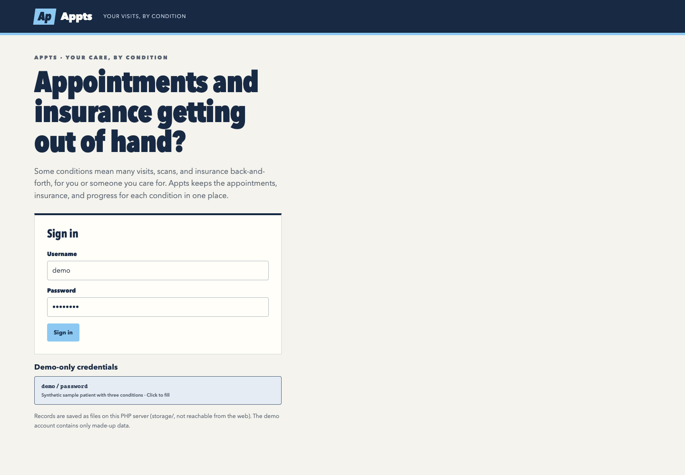

## Conditions overview

**Next up** lists the soonest dated item for each record across all your conditions. Each condition card counts its records by type and shows what's next. The search box searches doctors, visits, reference numbers, and notes.

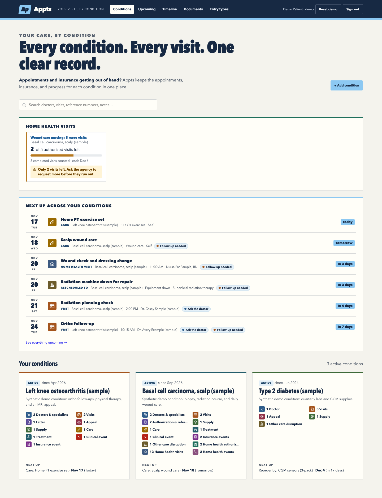

## A condition's workspace

Records are grouped by entry type, each with its own icon and color. You can filter by type, tag, or text. Every group has its own **+ Add** button, and **Add another kind of record** offers types that aren't in use yet. The sidebar shows this condition's next items and its rich-text notes.

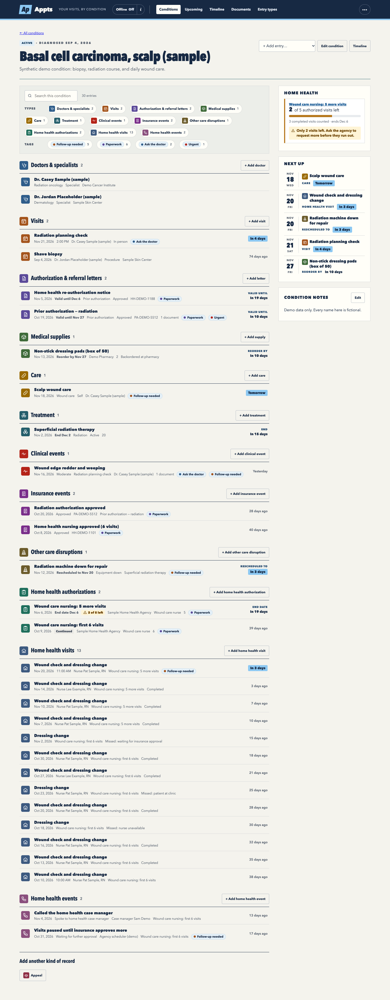

Open a record to see its details. Each record shows its link fields (for example, *Visit → Doctor* or *Appeal → Letter*), backlinks from other records that point to it, notes, tags, and attached documents.

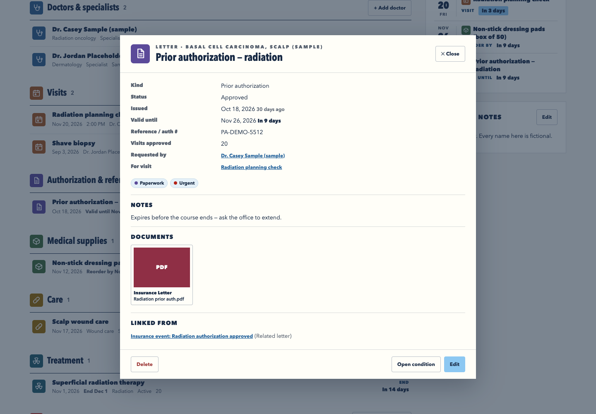
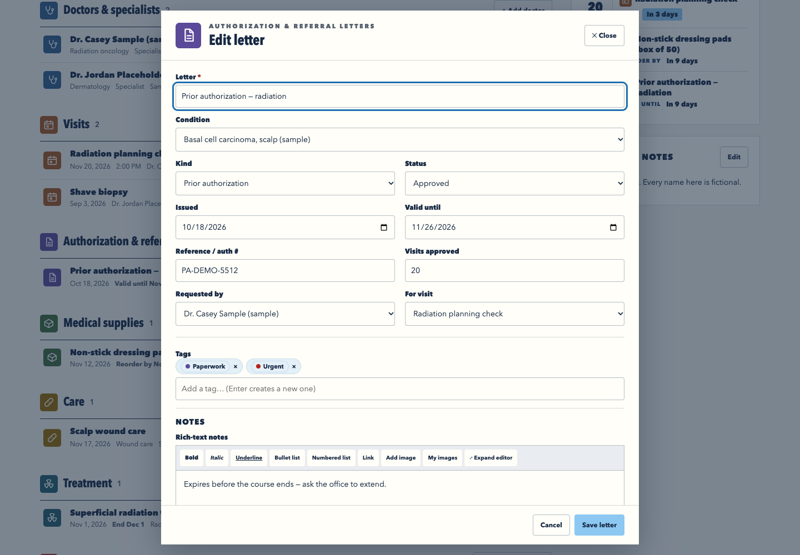

### Built-in entry types

| Type | Tracks |
| --- | --- |
| Doctors & specialists | Name, specialty, role, clinic, contact |
| Visits | Date and time, kind (In person, **Lab work**, Imaging, Telehealth, Phone, Urgent / ER, Procedure), doctor (optional for lab work), follow-up |
| Authorization & referral letters | Kind, status, reference number, valid until |
| Insurance appeals & coordination | Insurer, reference number, deadline, linked letter |
| Medical supplies | Supplier, quantity, status, reorder by |
| Care | Routine, who does it, next due |
| Treatment | Course, start and end dates, sessions |
| Clinical events | Severity, related visit (for example, "wound edges worse") |
| Insurance events | Outcome, reference, related letter (for example, "claim denied") |
| Other care disruptions | What broke, affected treatment, rescheduled date (for example, "radiation machine down") |
| Home health authorizations | Agency, nurse or discipline, authorized visit count, start and end dates, auth number, status, linked insurance event and letter, the authorization it continues |
| Home health visits | Date, nurse, linked authorization, outcome (Completed, Missed: waiting for insurance approval, Missed: nurse unavailable, Missed: patient at clinic, or your own) |
| Home health events | "Waiting for further approval", "Spoke to home health case manager", re-authorization requested, and so on (or your own), with who you spoke to and a follow-up date |

"Other care disruptions" is the name for the requested "logistics event" (renamed from "Care disruptions" in t11u). Every date field becomes a timeline event.

### Free-text statuses

Every built-in **Status** field (Visits, letters, appeals, supplies, Treatment) lets you pick a preset or choose **Free text…** and type your own, such as "Waiting on fax from PCP". Typed values are stored as the status. They show on rows, in details, and on the timeline, search and filter like presets, and come back under **Used before** next time. Any select field, including your own, can turn this on with **Allow free text** on the Entry types page.

### Home health

Home health nurses often stop coming while insurance reviews the next 5 to 7 visits, or miss a day because no nurse is free or you're at a clinic. Appts tracks this as three built-in types:

- An **authorization** shows a countdown such as **2 of 5 authorized visits left**. Only visits whose outcome is **Completed** count. Missed, scheduled, rescheduled, and typed outcomes are listed as "Not counted" with their reasons.
- The countdown appears on the authorization's row and detail, in a **Home health** box on the condition page, and in **Home health visits** on the overview.
- It warns when 2 or fewer visits are left, when all are used, and when an authorization is awaiting approval (status "Pending approval" or "Waiting for further approval", or a "Waiting for further approval" event linked to it).
- When a new authorization's **Continues authorization** field points at the old one, the old one reads "Continued" and leaves the overview.
- Home health visits and events are regular timeline entries, so the type chips and search filter them.

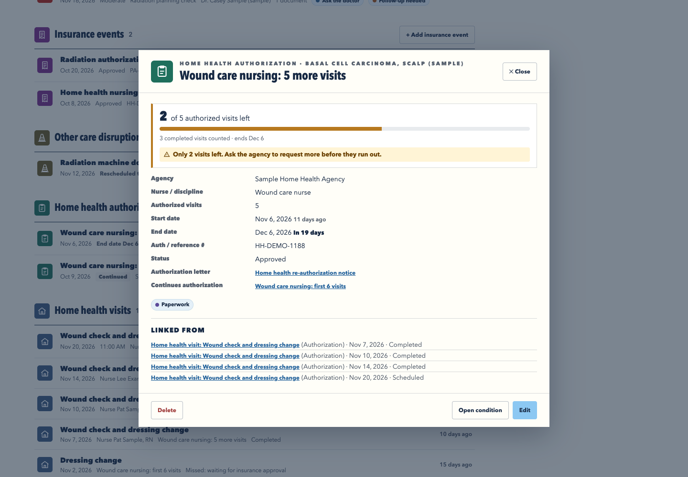

Existing accounts get the three types automatically (document version 3, appended after your own types, backed up first, records untouched). `php tools/migrate-dry-run.php <account>` shows what would change, using a temp copy.

## Timeline and Upcoming

The timeline groups events by month and marks today. Filter by condition, past or upcoming, text, **entry type** (chips show only the types that appear in the timeline), and **one or more tags**. Type chips combine with OR; tag chips with AND.

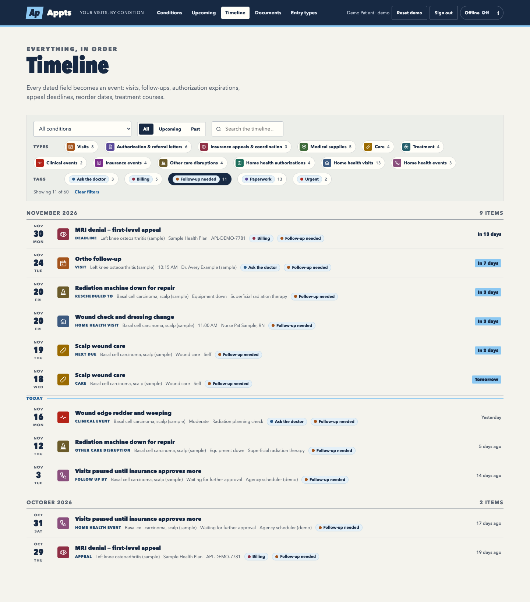
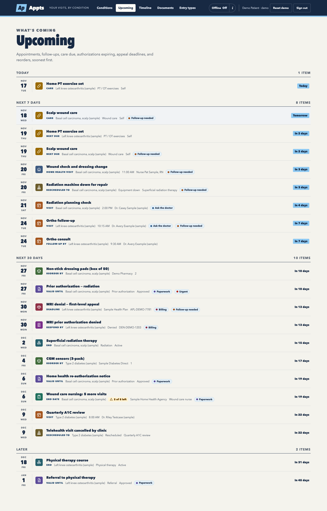

## Tags

Tags are optional. Type a new name in a record's tag picker and press Enter to create one on the fly. Records can have several tags.

## Rich notes and attachments

Every record and every condition has a rich-text note (bold, italic, underline, lists, links). Paste an image with **Ctrl/Cmd+V**, drag and drop it, or use the file picker. The server sanitizes HTML on save and the browser sanitizes it again on display. Only approved formatting, `http(s)`/`mailto` links, and this account's uploaded images survive.

## Documents

Attach PDFs or images to any record or condition, each with a **document label**: Lab, Consultation Note, PCP Note, Progress Note, Imaging, Discharge Summary, Insurance Letter, or Other. Type a new label to create one; it's saved and offered again next time. The **Documents** page filters by condition, file type, label, and name, groups by label or file type, opens PDFs in an inline viewer, and links each file back to its record.

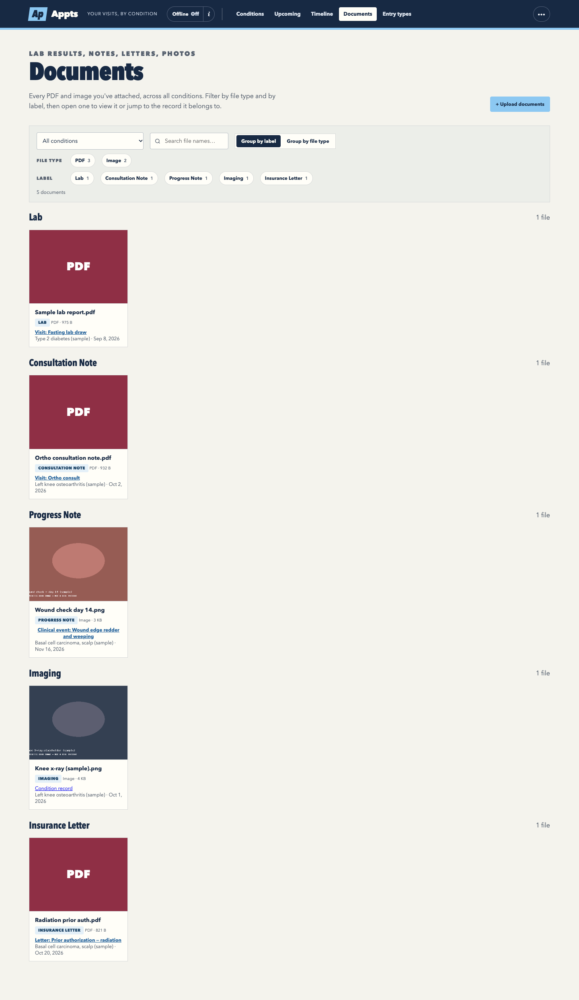
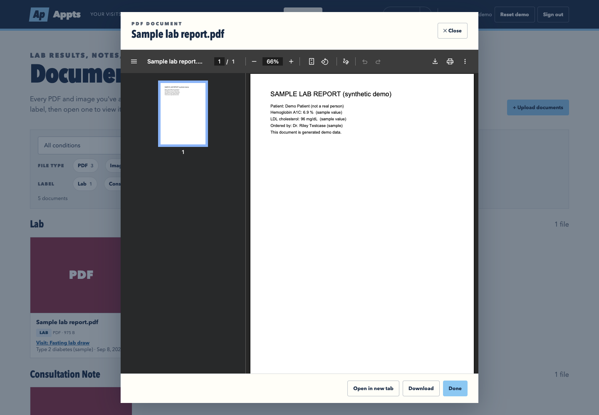

Accepted: PDF up to 20 MB (it must really be a PDF), and PNG, JPEG, GIF, or WebP up to 8 MB and 40 megapixels. Files are stored under their SHA-256 hash, per account.

## Extensible entry types

**Entry types** lets you rename any type, choose its icon and color, add, remove, or reorder fields, and add new types. Field kinds are text, long text, date, number, select, checkbox, and link to another record. A custom type with no icon gets a placeholder icon. Badge text is always black or white, whichever reads better.

Removing a field or archiving a type **never deletes data**. Removed fields' values stay visible on the record under "Removed fields". Archived types leave the Add menus, but their records stay.

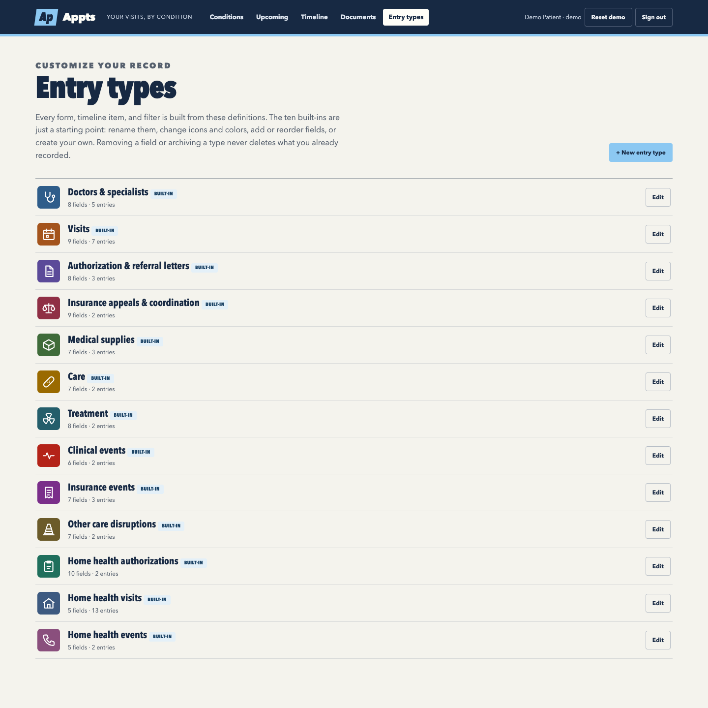
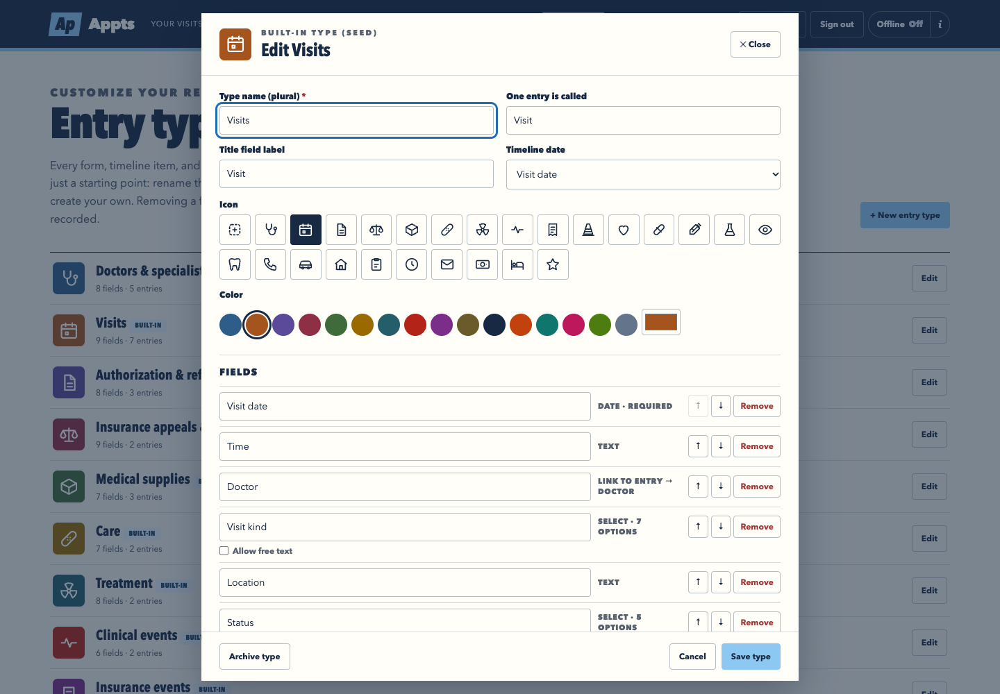

## Mobile

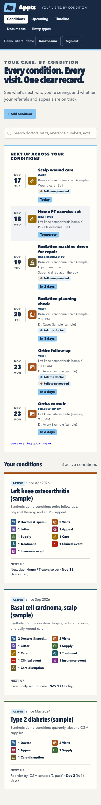 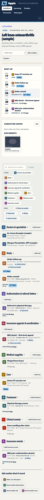

## Offline mode
For clinics that don't share their internet. **Turn it on first, while you're still online:** the **Offline Off/On** button in the header opens a panel. Choose which conditions' documents to keep (records and the app are always saved), check the size against the free space shown, and press **Turn on Offline mode** (it shows "Saving n of N…"). After that every page, including the front page URL, every view, and the saved documents open from the copy on the device, even with no connection. Changes made there (edits, new entries, pasted photos, entry type edits) stay on the device. Back online, turn the mode off and press **Sync**: Appts merges them with anything changed on the server meanwhile, and a clash keeps the server value and writes yours into the notes. Signing out waits until everything is synced, then removes the copy. The (i) button explains it with a picture.

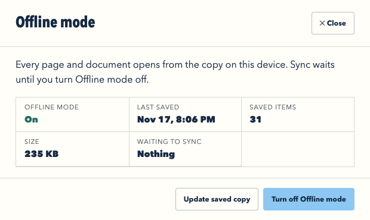 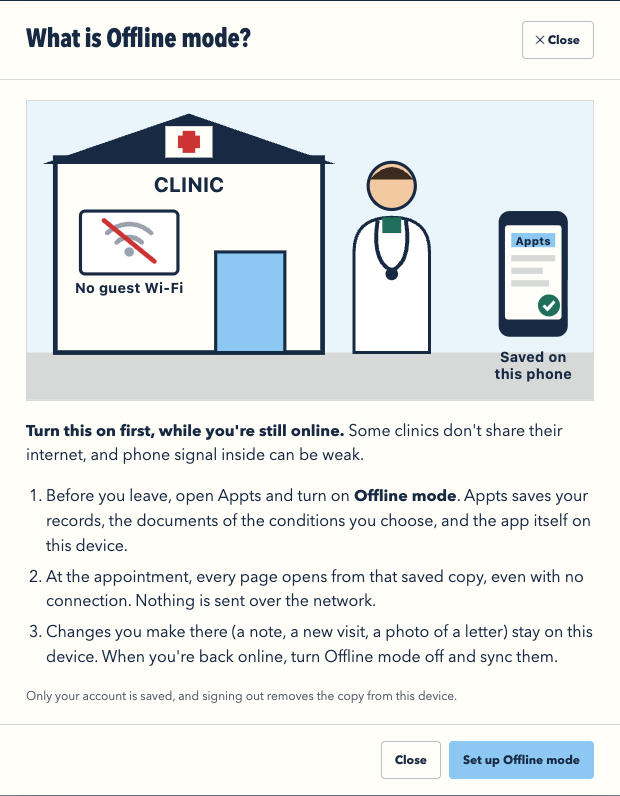

Needs a browser with service workers on `http://localhost` (MAMP or php -S) or https. Design and rules: [docs/OFFLINE_MODE.md](docs/OFFLINE_MODE.md).

## Where data lives

All data is stored on the server, per account, under `storage/` (or `APPTS_STORAGE_DIR`):

| Path | Contents |
| --- | --- |
| `storage/data/<account>.json.php` | Conditions, types, entries, tags, labels, sanitized notes |
| `storage/backups/<account>/` | The last 20 versions, written before each save |
| `storage/uploads/<account>/` | Uploaded images and PDFs (`<sha256>.<ext>.php`) |
| `storage/locks/` | Per-account `flock` files |

Every stored file is a `.php` file that starts with `<?php http_response_code(404); exit; ?>`, so even `php -S` without a router returns 404 instead of the bytes. Apache also gets `storage/.htaccess` (`Require all denied`). Writes are atomic (temp file plus rename) under an exclusive lock. Files are served only through `api.php` after the session check, with `nosniff`. Images also get a sandbox CSP.

## Log updates with an AI agent

`.agents/skills/log-health-update/SKILL.md` lets an AI coding agent working in this folder (Cursor, Claude Code, and similar) turn whatever you drop in, such as photos, screenshots, PDFs, or a few sentences about what happened, into Appts records:

1. The agent asks which account (`demo` or `wf`) and which condition, or offers to create a new one. It never asks for a password, because it works on the files directly.
2. It reads the files, extracts the facts, and maps them to that account's own entry types, custom ones included.
3. It shows a short preview of the entries it will create or update and waits for you to confirm.
4. It saves them through `tools/intake.php`, which uses the same storage code as the app: locked, atomic writes with a backup first. Files are copied into uploads with a document label, and tags and cross-links are added. The helper never deletes anything and never overwrites a value that's already filled in.

Reload Appts to see the new entries. For the plan format and commands, see the skill, or run `php tools/intake.php help`.

## Tests

```sh
sh tests/run-all.sh                 # every gate
sh tests/run-all.sh --screens       # also regenerate docs/screenshots
```

| Test | Covers |
| --- | --- |
| `php -l` | Every PHP file |
| `tests/storage.test.php` | Guarded storage, atomic writes, locks, backups, sanitizer, domain ops, migrations |
| `tests/intake.test.php` | `tools/intake.php` on `demo` and a temporary account (never `wf`): listing, dry run, append-only apply, links, tags, labels, uploads, refusals, and the SKILL.md example. Runs on PHP 8 and 7.4. |
| `tests/schema.test.mjs` | Type, field, timeline, filter, tag, icon, contrast, and document helpers; home health countdown math |
| `tests/api.test.py` | Real `php -S`: logins, account isolation, blocked storage URLs, concurrent writes, restart persistence, uploads, labels |
| PHP 7.4 gate | `php -l` on every file with MAMP's 7.4 binary plus the storage tests on 7.4. Set `APPTS_PHP=<binary>` to run the whole suite on another PHP. |
| `tests/live.check.py` | Against a running MAMP/Apache: JSON API, both logins, cookie path, uploads (including 17 MB), blocked storage and server-only dirs, isolation, paste, service worker scope under the subpath and Offline mode, screenshot |
| `tests/browser.test.py` | Playwright: sign-in, custom types and fields, paste and drag-drop uploads, tags, rich notes, XSS stripping, Documents filters, home health countdown and warnings, 390px layout |
| `tests/offline.test.py` | Playwright + `php -S`: Offline mode on with the server up, then the server stopped (every view, a PDF, an image, miss page), queued edits and a pasted image, restart, sync merged with a server edit, version update, full-disk stop, sign-out cleanup; demo plus a temp account, never `wf` |
| `tests/merge.test.mjs` | Offline sync merge rules: local apply, overlay, three-way merge, delete/restore cases, op order, id remap |

The browser test needs Python Playwright with Chromium. `--screens` uses installed Google Chrome when it's present (`APPTS_BROWSER_CHANNEL=chrome`, temporary profile) because Playwright's headless shell can't render PDFs. Tests use temporary storage and never touch `storage/`.

## Files

- `index.php`, `includes/head.php`, `includes/layout.php`, `includes/footer.php`: the page shell and security headers.
- `api.php`: session, login, data, ops, uploads, and file serving.
- `includes/storage.php`, `includes/uploads.php`, `includes/sanitize.php`: guarded storage, upload validation, and the HTML allowlist.
- `includes/domain.php`, `includes/seed-types.json`, `includes/demo-seed.php`: types, validation, operations, and synthetic demo data.
- `includes/auth.php`, `includes/accounts.php`, `tools/set-password.php`: accounts.
- `js/app.js` (views), `js/forms.js` (forms and detail), `js/typesPage.js`, `js/schema.js` (pure domain), `js/documents.js`, `js/icons.js`, `js/richText.js`, `js/store.js`, `js/api.js`, `js/images.js`, `js/ui.js`.
- `tools/intake.php`, `.agents/skills/log-health-update/SKILL.md`: the AI intake helper and skill. `tools/migrate-dry-run.php`: preview a document migration on a copy.
- `sw.php` + `includes/sw.js`, `manifest.php`, `assets/`, `includes/version.php`, `includes/offline.php`, `js/offline.js`, `js/outbox.js`, `js/merge.js`: Offline mode (see `docs/OFFLINE_MODE.md`).
- `docs/`: epics, milestones, prompts, implementation notes, and the gauntlet contract and state.

Appts is a personal record-keeper, not a medical device or an official health record. Demo data is fictional.
